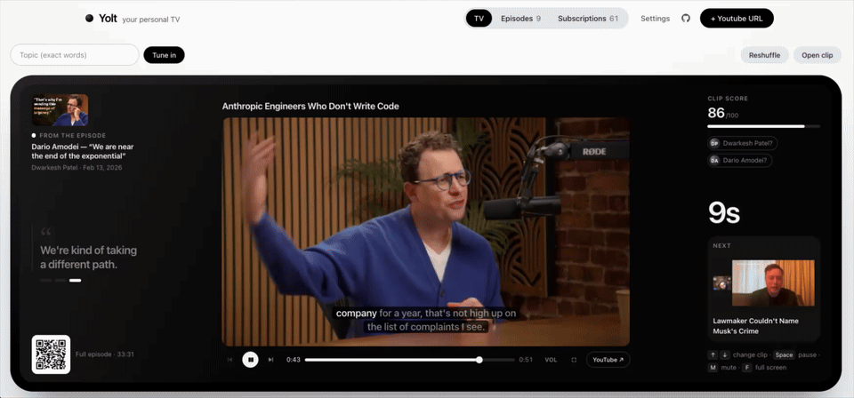
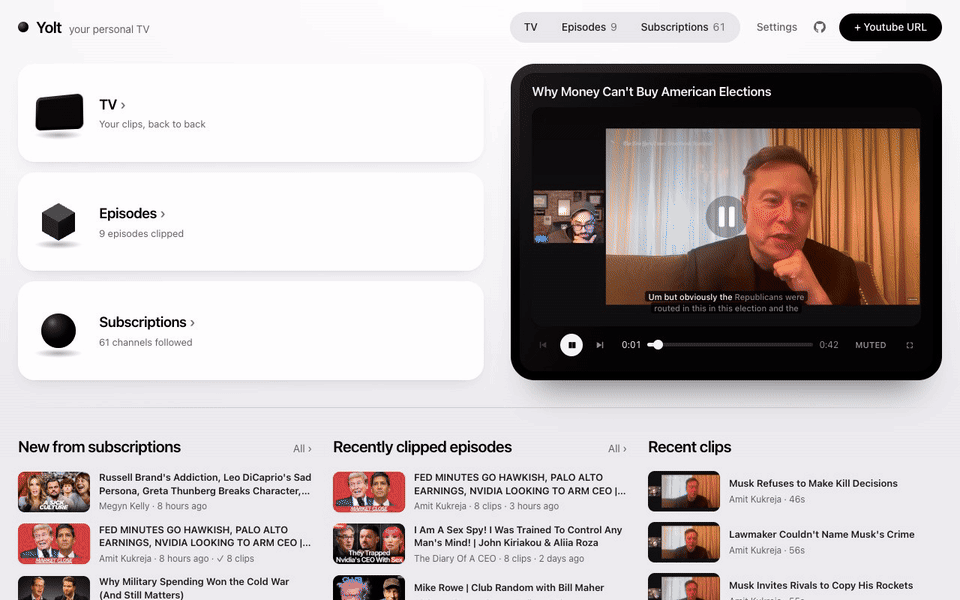
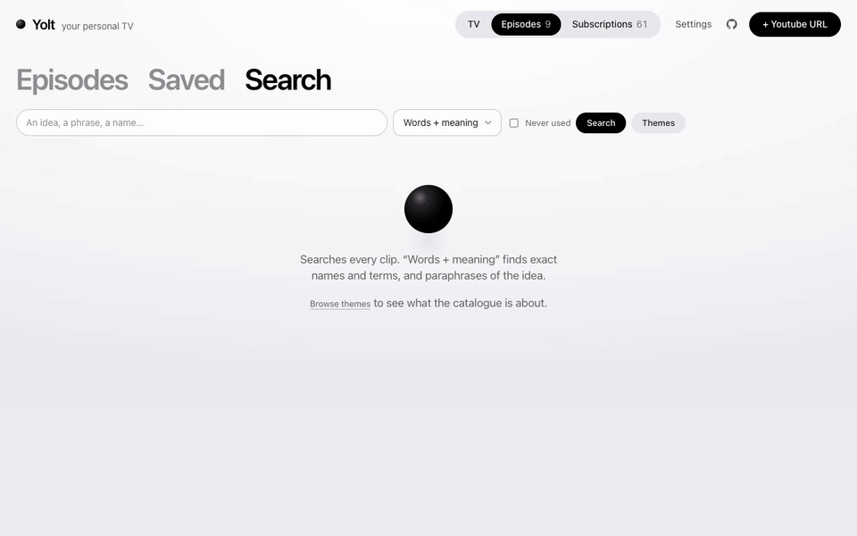
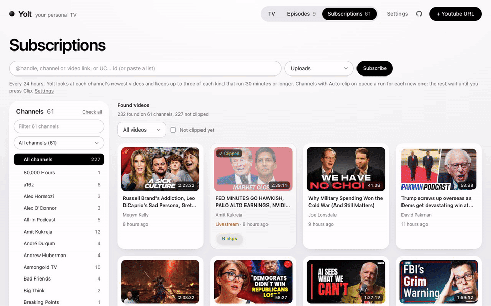
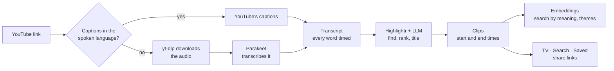

<div align="center">

# Yolt.app

**your personal TV**

Paste a link to find clips.<br>
Follow channels, search by words or meaning, and watch your clips back to back.<br>
Each clip plays a time range in the original video.


[Features](#features) · [Why Yolt](#why-yolt) · [New to Yolt?](#new-to-yolt) · [Quick start](#quick-start) · [Using it](#using-it) · [The services](#the-services) · [When something goes wrong](#when-something-goes-wrong) · [How it works](#how-it-works) · [Limits](#limits) · [Reference](#reference)



<sub>Watch back to back. Scan the QR code to open the original video at that moment.</sub>

</div>

## Features

✅ **Auto-collecting from subscriptions.** Follow a channel's uploads, its finished livestreams, or both, and once a day Yolt collects the new ones that run 30 minutes or longer.\
✅ **Auto-clipping.** Tick **Auto-clip new videos** on a channel and every new video it finds is clipped without you pressing anything.\
✅ **Auto-detection of the best moments.** Highlightr reads the whole transcript, ranks every moment worth clipping, and keeps the best ones that don't overlap.\
✅ **Get exactly what you're looking for.** Ask for "the funniest moments", or change the clips' length and number for that link only.\
✅ **Transcripts from YouTube when it can.** The video's own captions when it has them, Parakeet when it doesn't, with every word timed.\
✅ **Nothing to render.** A clip is a start and an end time on the original video, so it takes no space and is ready the moment its run is.\
✅ **A TV of your clips.** Back to back, favouring the newest, never two from one episode in a row, with a live transcript, a countdown and what's next.\
✅ **The full episode on your phone.** A QR code on the TV opens the episode at the clip's moment.\
✅ **Search by words or by meaning.** Exact words, the same idea in other words, or both, plus **More like this** on any clip.\
✅ **Themes.** See what your catalogue is about, grouped by meaning, and search within any of them.\
✅ **Saved and For you.** Keep clips with **+**, and the home page shows clips like the one you saved last.\
✅ **A link for every clip.** `/c/<clip id>` plays just that moment.\
✅ **Light or dark.** Dark mode, and the nav on top or down the side, in **Settings → Appearance**.\
✅ **One API for everything.** The UI uses the same documented API you can call yourself.\

## Why Yolt

A two-hour podcast usually has a handful of moments worth sharing. Finding them means watching the whole thing, and turning them into clips means cutting and exporting video files. Yolt does both from a link.

| | by hand | with Yolt |
|---|---|---|
| Finding the best moments | watch the episode | paste the link; Highlightr reads the transcript and picks them |
| The transcript | none, or YouTube's captions | YouTube's captions when there are some, Parakeet otherwise; every word has its time |
| Making a clip | cut and export a video file | a start and an end time on the original video, played through YouTube's own player |
| New episodes from channels you follow | check each channel | checked once a day, and clipped automatically if you like |
| Finding a moment again | scrub through videos | search every clip by its exact words or by what it's about |
| Watching them | one at a time | the TV plays them back to back, newest first, without repeats |

## New to Yolt?

You give Yolt a YouTube link. It gets the video's transcript, sends it to **Highlightr**, which uses an LLM to pick the moments most worth clipping, and keeps each moment as a clip. Clips are searchable right away, play on the TV, and each has a link you can share.

A few words come up a lot below:

| word | what it means here |
|---|---|
| episode | one YouTube video |
| run | one go at clipping an episode. You can clip the same video as many times as you like; each run reuses its transcript |
| clip | one moment of an episode: a start time, an end time, a title, and the words said |
| focus | what you'd like the clips to be about ("the funniest moments"). Optional; Settings has the default |
| subscription | a YouTube channel Yolt checks for new long videos |
| auto-clip | a subscription that clips every new video it finds, without you pressing anything |
| theme | a group of clips about the same thing, found by meaning rather than by keywords |

## Quick start

You need Docker with Compose. The Yolt image includes Python, ffmpeg, and Deno.

Start the local stack with the command below. Highlightr needs a reachable LLM to process clips, and Parakeet transcribes videos without usable captions. See [Running the services yourself](#running-the-services-yourself) for LLM setup.

```bash
make
```

Then open **http://127.0.0.1:8485**, press **+ Youtube URL**, and paste a link.

The first `make` writes `.env` and `.db-password` with a random password, builds the Yolt image, and starts Yolt, PostgreSQL, Parakeet, and Highlightr in the background. All four ports are published on localhost only. PostgreSQL keeps the catalogue in its Compose volume, and Yolt keeps thumbnails and retry audio in `./data`. Run `make stop` to stop Yolt.

To customize a fresh setup before starting Yolt, copy [`.example.env`](.example.env) to `.env`, edit it, then run `make`. It fills in the missing database URL and uses the existing `.db-password` if present. If you invoke Compose directly, run `make .env` first to initialize the files. The localhost addresses for Parakeet and Highlightr map to the matching Compose services when Yolt runs in a container. To manage an address in **Settings** instead, comment out its variable in `.env` and run `make` again.

## Using it

### Clip a video

Press **+ Youtube URL** anywhere, or **Clip** on a video a subscription found. Yolt checks the link with YouTube first and tells you which transcript it will use. Type a focus if you want one, and press **Submit**.

<div align="center">

</div>

The run's page then shows each step as it happens: fetching the video's details, getting the transcript, then Highlightr finding, ranking and titling the moments.

> Demo GIF to come: a run going from "Fetching info" to its clips (`docs/media/run.gif`). It needs a real run to record.

| if you want | do this |
|---|---|
| clips about something in particular | type it in **What should the clips focus on?** |
| longer or shorter clips, or more or fewer of them, for this link only | open **Clip options** under the focus box; an empty field uses Settings |
| the same for every link | **Settings → Clips** |
| another set of clips from a video you've clipped | submit it again; the popup links to the last run, and the transcript is reused |
| a run that failed or was cancelled to go again | **Retry** on its page; it reuses the audio or transcript it already has |

### Watch the TV

**TV** in the top nav plays your clips one after another, favouring the newest and the ones it has played least, and never two from the same episode in a row while there are others. In a clip's last 5 seconds the next one starts out of sight, so it slides in already playing.

| key | does |
|---|---|
| ↑ / ↓ | previous / next clip |
| Space | pause |
| M | mute |
| F | full screen |

The topic box tunes the TV to clips with those words, and every channel is a link you can bookmark: `/tv?q=jobs`, `/tv?usage=never`, `/tv?theme=…`. **Settings → TV** sets how strongly it favours new clips. Clips play through YouTube's player signed in as you, so with YouTube Premium there are no ads.

Browsers only allow sound after a click or a key press on the page. Opened from the nav, the TV starts with sound; opened straight from a bookmark, it starts muted until you click. To have it start with sound anyway, allow autoplay for Yolt's address in the browser's site settings.

### Search and save

<div align="center">

</div>

Open **Episodes → Search** to find clips.

| Mode | Finds |
|---|---|
| **Words + meaning** | Exact and semantic matches |
| **Exact words** | Clips that say what you typed |
| **Meaning only** | Clips about the same idea |

Use **Never used** to filter out clips already used in compilations. Browse **Themes** or choose **More like this** on a clip. **+** saves a clip in this browser, and **For you** shows similar clips on the home page.

### Follow channels

<div align="center">

</div>

On **Subscriptions**, paste a channel link, an `@handle`, a `UC…` ID or a link to any of its videos, and choose uploads, finished livestreams, or both. Once a day Yolt looks at each channel's 5 newest uploads and 25 newest streams, and keeps up to three new ones of each that run 30 minutes or longer. Live, upcoming and members-only videos are skipped.

| if you want | do this |
|---|---|
| to clip a video it found | **Clip** on the video, or tick several and press **Clip N** in the bar that appears |
| every new video clipped without asking | tick **Auto-clip new videos** on the channel. Each video is auto-clipped at most once |
| checks more or less often, or shorter videos kept | **Settings → Subscriptions** (0 hours: only when you press **Check now**) |

### Settings

Settings are grouped as Subscriptions, Clips, TV, Transcription, Highlights · Highlightr, Search · Embeddings and Appearance. An empty field uses its default, shown in grey. **Appearance** switches to dark mode (or matches the system) and moves the nav to the left side, in this browser only. **Clear all**, at the bottom, deletes every episode, run and clip for a fresh start; subscriptions and settings stay.

## The services

Yolt does the bookkeeping. The heavy work is done by services on your network:

| service | what it does | default address | if it's down |
|---|---|---|---|
| **Parakeet** | transcribes a video that has no usable captions | `http://parakeet-cpu:5092` in Compose | videos without captions in their spoken language can't be clipped. Videos with captions don't need it |
| **Highlightr** | picks and ranks the moments | `http://highlightr-api:8000` in Compose | nothing can be clipped. Everything already clipped still works |
| **LLM** | used by Highlightr to find, rank and title moments, and by Yolt to work out who's in an episode | Yolt override off | clipping needs Highlightr’s LLM. Automatic speaker inference needs a Yolt LLM endpoint |
| **Embeddings** | turns clips and searches into vectors for search by meaning | Off | **Exact words** still works. Semantic search becomes available once an embeddings endpoint is configured and clips are embedded |

Press **Test** next to each in Settings to check it from Yolt.

### The LLM endpoint

The **LLM endpoint** setting is used in two places. Yolt calls it to work out who's in an episode. It also sends it to Highlightr with every job, and Highlightr then uses it **instead of** the LLM Highlightr was started with. That means:

- If the endpoint in Settings is down, clipping fails, even if Highlightr's own LLM is fine.
- By default Yolt leaves Highlightr on its own LLM. Automatic speaker inference is off, and you can add speakers by hand on an episode's page.
- To turn off a saved override, clear the field in Settings or set `YOLT_LLM_ENDPOINT=` in `.env`.

**Test** on the LLM sends it a real (tiny) request, so if your LLM charges per request, each press is a request.

## When something goes wrong

| you see | what it means | what to do |
|---|---|---|
| `Could not reach Parakeet at …` | the transcription service isn't answering | start Parakeet, or fix its address in **Settings → Transcription**, then **Retry**. The audio is kept for a day, so it isn't downloaded again |
| `Could not reach Highlightr at …` | the highlight service isn't answering | start Highlightr, or fix its address in **Settings → Highlights · Highlightr**, then **Retry**. The transcript is kept |
| `Highlightr job failed: … chat endpoint …` | Highlightr couldn't use the LLM | check the LLM endpoint, model and key in **Settings → Highlights · Highlightr**, then **Retry** |
| `Semantic search is unavailable` | the embedding server isn't answering | use **Exact words**, or check **Settings → Search · Embeddings** |
| a run sits at "Queued" | runs go one at a time, oldest first | wait, or cancel the one in progress on its page |
| a TV clip is skipped as "won't play here" | the video's owner doesn't allow it to play on other sites | nothing; it's remembered in this browser. **Try N skipped videos again** brings them back |
| the TV is silent | the browser held back sound until a click | click anywhere, or press M |
| no speakers on an episode | the LLM couldn't be reached, or is turned off | add them on the episode's page; Yolt retries by itself every few minutes |

## How it works



1. **The transcript comes from YouTube when it can.** Creator captions are preferred over auto-generated ones, only tracks in the video's own language are used, and captions that stop well short of the video are passed over for Parakeet. **Settings → Transcription** can use creator captions only, or always transcribe.
2. **Highlightr reads the transcript in 10-minute stretches.** It proposes a few moments in each (3 by default), ranks them all together, and keeps the best ones that don't overlap (8 by default).
3. **A clip is only times.** It plays in YouTube's embedded player from its start to its end, so clips take no space and appear the moment a run is ready.
4. **One run at a time.** Runs wait in a queue, oldest first, so two transcriptions never compete for the GPU. A run that was going when Yolt stopped carries on where it can when Yolt starts again.
5. **Everything goes through one API.** The UI uses the same API you can call yourself, described in `spec/yolt.openapi.json` and shown at `/api/docs`.

## Limits

What Yolt doesn't do:

- **Serve anyone else.** It has no accounts, so Compose publishes the web port only on `127.0.0.1` on the host. To use it from another machine, open an SSH tunnel with `ssh -L 8485:127.0.0.1:8485 <host>`. Share links only work where Yolt can be reached.
- **Make video files.** Clips play through YouTube. A video that's removed, made private, or not allowed to play on other sites can't be watched in Yolt either.
- **Clip without its services.** Highlightr and an LLM are always needed, and Parakeet for videos without captions.
- **Clip more than one video at a time.**
- **Keep Saved clips across browsers.** They're stored in the browser you saved them in.
- **Punctuate auto-captions.** Clips from YouTube's auto-generated captions are lowercase and cut on pauses rather than at sentence ends.
- **Look far back on a channel.** A check only sees a channel's 5 newest uploads and 25 newest streams.

## Reference

### Commands

| command | does |
|---|---|
| `make` | builds Yolt and starts it at http://127.0.0.1:8485 alongside PostgreSQL, Parakeet, and Highlightr |
| `make stop` | stops the Yolt container |
| `make dev` | runs Yolt on the host with live reload and starts PostgreSQL if needed |
| `make db`, `make db-stop` | starts or stops PostgreSQL only |
| `make services`, `make services-stop` | pulls and starts, or stops, local Parakeet and Highlightr |
| `make services-pull` | pulls the published Parakeet and Highlightr images without starting them |
| `make db-rotate-password` | gives the database a new random password. Run `make` again to apply it to the Yolt container |
| `make embed` | embeds every clip still missing a vector, now |
| `make speakers` | works out speakers for every episode still missing them, now |
| `make fake` | placeholder Parakeet, Highlightr and embeddings services, for working on the UI without a GPU |
| `make test` | the tests; they start their own throwaway PostgreSQL, so they need PostgreSQL 16 installed (`brew install postgresql@16`) |

### Environment variables

Set these in `.env`. A service address set here overrides Settings and shows as locked there.

| variable | default | |
|---|---|---|
| `YOLT_PORT` | `8485` in Compose | the host port. Direct Python launches default to `8484` |
| `YOLT_HOST` | `127.0.0.1` | applies to direct Python launches. Compose publishes only on host loopback |
| `YOLT_DATABASE_URL` | | written by `make`. The container maps its local database address to `db:5432` |
| `YOLT_DB_PORT` | `5489` | the database's port on 127.0.0.1 |
| `YOLT_DATA_DIR` | `./data` | clip thumbnails, and audio kept a day for a retry |
| `YOLT_PARAKEET_URL`, `YOLT_PARAKEET_MODEL` | `http://parakeet-cpu:5092` in Compose, `parakeet-tdt-0.6b-v3` | host mode uses `http://127.0.0.1:5092` |
| `YOLT_HIGHLIGHTR_URL` | `http://highlightr-api:8000` in Compose | host mode uses `http://127.0.0.1:8000` |
| `YOLT_YOUTUBE_CAPTIONS` | `any` | `any`, `manual` (creator captions only) or `off` (always Parakeet) |
| `YOLT_LLM_ENDPOINT`, `YOLT_LLM_MODEL`, `YOLT_LLM_API_KEY` | empty | empty `YOLT_LLM_ENDPOINT` leaves Highlightr on its own LLM and turns speakers off |
| `YOLT_EMBED_URL`, `YOLT_EMBED_MODEL` | URL empty, model `Qwen/Qwen3-Embedding-8B` | set the URL to enable search by meaning |
| `YOLT_LABS_DISABLED` | | labs to switch off, e.g. `thread,foryou` |

### The API

Everything the UI does goes through the API at `http://127.0.0.1:8485/api/v1`. The full reference is at **http://127.0.0.1:8485/api/docs**; the hand-written spec in `spec/yolt.openapi.json` is the source of truth.

```bash
B=http://127.0.0.1:8485/api/v1
curl -X POST $B/runs -H 'Content-Type: application/json' \
     -d '{"url": "https://www.youtube.com/watch?v=...", "options": {"max_clips": 5}}'   # clip a video
curl "$B/runs/1?include=clips"                                   # poll until status is "ready"
curl "$B/clips?q=fear+of+AI+taking+jobs&search=hybrid"           # search by words and meaning
curl "$B/clips?like=12"                                          # clips like clip 12
curl "$B/themes"                                                 # what the catalogue is about
curl -X POST $B/subscriptions -H 'Content-Type: application/json' -d '{"url": "@somechannel", "autoclip": true}'
```

Errors are `application/problem+json` and list every problem at once, each pointing at the field it's about.

### Running the services yourself

Parakeet and Highlightr run from the published RipeClips images, `joonfjp/parakeet:1.0.0` and `joonfjp/highlightr:1.0.0`, in this repository's `compose.yaml`. No RipeClips checkout or image build is needed:

```bash
make services
```

This pulls and starts just Parakeet and Highlightr. Run `make services-stop` to stop them. Parakeet runs on CPU and keeps downloaded models in a project-scoped Docker volume across restarts. Its first startup can take longer while models download.

Containerized Yolt reaches Parakeet and Highlightr by their Compose service names. Press **Test** in Settings to check that Yolt can reach them. For a service outside Compose, use an address reachable from the container, such as its LAN address.

Highlightr defaults to the host's OpenAI-compatible LLM at `http://host.docker.internal:8080/v1`, model `gemma4`. Override `LLM_BASE_URL`, `LLM_MODEL`, and optionally `LLM_API_KEY` in `.env` or when starting the services:

```bash
LLM_BASE_URL="http://host.docker.internal:11434/v1" LLM_MODEL="your-model" make services
```

Yolt's **LLM endpoint** setting overrides Highlightr's LLM for each job. To enable the override, set `YOLT_LLM_ENDPOINT` to an address reachable from both Yolt and the Highlightr container. Leave it blank to use Highlightr's own LLM.

For UI work with `make dev`, `make fake` starts placeholder services on the host at `http://127.0.0.1:5092` (Parakeet), `http://127.0.0.1:8000` (Highlightr) and `http://127.0.0.1:8098/v1/embeddings`. Set those addresses in `.env` to use the placeholders.

### Working on Yolt

- Host development needs [uv](https://docs.astral.sh/uv/), ffmpeg, and Deno. Run `make stop` before switching to `make dev` on the same port. If you already have a host Yolt process running, stop it before starting containerized Yolt with `make`.
- The schema changes in numbered files in `yolt/migrations`, applied in order when Yolt starts.
- A full `make test` fails if any API operation in the spec has no test.
- **Labs** are experimental features, each easy to remove: `yolt/labs/__init__.py` lists what to delete. **Thread** (an idea in, an ordered reel out) is hidden for now; **For you** is on the home page.
- Only one Yolt server processes runs per database. A second one started on the same database serves the UI and the API but leaves the queue alone.

## Credits

Yolt transcribes with [Parakeet](https://huggingface.co/nvidia/parakeet-tdt-0.6b-v3) and picks moments with Highlightr, the services from RipeClips. It reads YouTube with [yt-dlp](https://github.com/yt-dlp/yt-dlp), stores everything in PostgreSQL with [pgvector](https://github.com/pgvector/pgvector), and searches by meaning with [Qwen3-Embedding](https://huggingface.co/Qwen/Qwen3-Embedding-8B). The TV's QR codes are drawn by [qrcode-generator](https://github.com/kazuhikoarase/qrcode-generator) by Kazuhiko Arase (MIT), vendored in `yolt/static/vendor/`.
